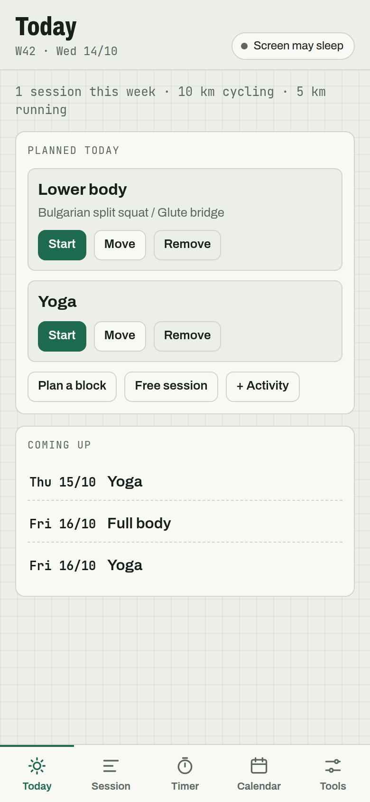
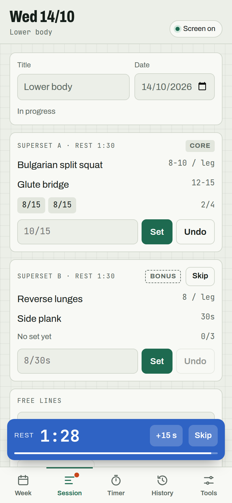
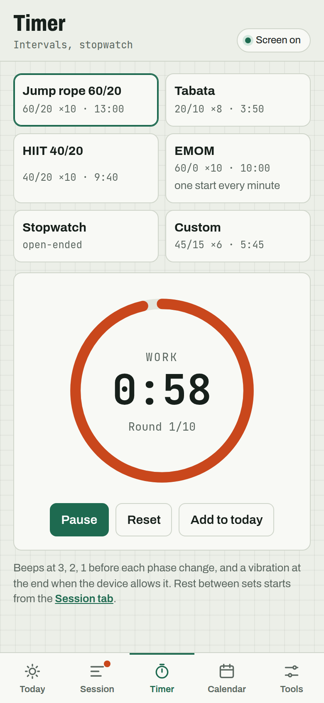
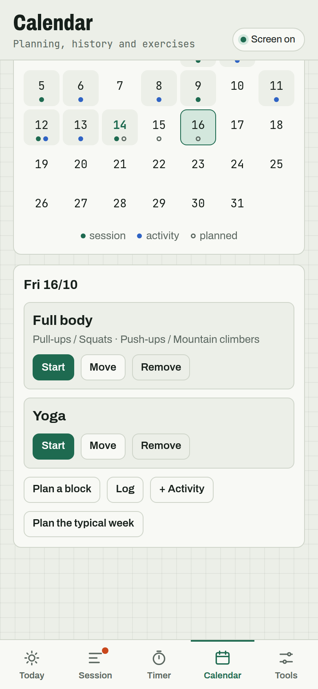
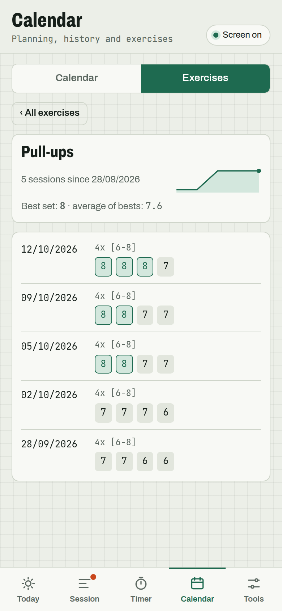
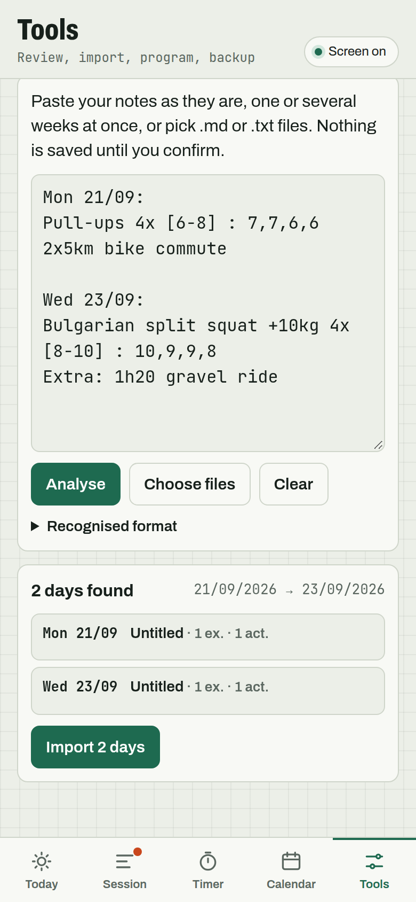

<p align="center">
  
</p>

<h1 align="center">LightGym</h1>

<p align="center">A training log that reads your notes the way you write them.</p>

<p align="center"><a href="https://lightgym.vercel.app/"><b>Open the app → lightgym.vercel.app</b></a></p>

> [!NOTE]
> This is a personal project, vibe-coded for my own use. It brings together, in a simpler form, a few apps I like: Calistree for training, Seconds Pro for interval timers, and plain-text notes for logging. The app is public and free to use, but I make no promise that it works, that it is complete, or that it will keep evolving.

---

Most workout apps make you pick every exercise from a built-in library. If your movement isn't there (a front lever variation, a home-made superset, an unplanned climbing session), you either fake it or give up. At the other end, a phone note accepts anything but does nothing for you during the session (rest, timers) or after it (progress, history).

LightGym sits in between. You write the way you would in a notebook:

```
Pull-ups +12kg 4x [5-6] : 6,5,4,4
```

The app reads the exercise name, load, number of sets, target range and your results, and highlights the sets that reach the top of the range. It never rejects a line: anything it doesn't understand is kept as a note.

<p align="center">
  
  
  
</p>
<p align="center">
  
  
  
</p>

## What it does

**Planning**
- Your program is written as plain text. Each heading becomes a block: a strength session, yoga, a run.
- You place blocks on the calendar, move them when your week shifts, repeat one over the week, or plan your typical week in one tap.
- The Today screen shows what is planned today, what you've done and what comes next. Opening a block shows its content without starting anything.

**During a session**
- One block at a time: the current exercise stays in focus and the app moves to the next block once its sets are logged.
- Logging a set starts the rest timer, with 3-2-1 beeps and a vibration at the end.
- A hold timer measures a plank or a front lever and fills in the value for you.
- Timed blocks (yoga, a mobility routine) run step by step on their own, with cues, side switches and the time actually spent logged at the end.
- "Bonus" blocks can be skipped with one tap when time runs short.
- The screen stays awake while you train, so you don't unlock your phone between sets.

**Around your sessions**
- Interval timers: jump rope 60/20, tabata, HIIT, EMOM, custom settings, plus a stopwatch.
- Outside activities (cycling, running, hiking, climbing, yoga…) take two taps to add, with duration, distance and pace.

**Afterwards**
- The calendar shows done sessions, activities and distances alongside what is planned.
- Each exercise has its own history and curve; supersets are split into their two exercises.
- Bulk import takes weeks of notes pasted as they are, with a preview before anything is saved.
- A week exports to Markdown (Obsidian-friendly), or to a review prompt ready to paste into an AI assistant, with your context, program and progress.

## Your data stays with you

There is no account, no server and no tracking. Everything is stored in your device's browser. You can export and restore a JSON backup from Tools → Backup, which is also how you move between devices.

On iPhone or iPad, open the app in Safari, then Share → Add to Home Screen. It then opens full screen and works offline, and Safari no longer clears its data after 7 days without a visit.

## English or French

The interface is available in English and French. It follows your device language by default; you can change it in Tools → Settings. Notes and programs are read in both languages whatever the setting, so `Mon 05/10` and `Lun 05/10`, `Other:` and `Autre :`, `rest 1:30` and `repos 1:30` all work. Markdown exports and review prompts use the interface language.

## Writing your notes

There is no strict syntax, just a few markers:

```
# Week of 05/10

## Mon 05/10 — Upper body
* Pull-ups +12kg 4x [5-6] : 6,5,4,4
* Front lever one-leg 5x [8-12s] : L 12s, R 12s, L 11s, R 11s
* Pistol / Goblet squat 20kg 4x [5-6 / 8-10] : 6/10, 6/10, 5/10
Other:
- Bike 7 km
Note: a bit tired.

## Tue 06/10 — Cardio
- Running 3 km in 19 min
```

| Marker | Meaning |
|---|---|
| `4x` | number of sets |
| `[5-6]`, `[8-12s]` | target (reps or seconds) |
| `+12kg`, `20kg` | load |
| `6,5,4,4` | result of each set |
| `L 12s`, `R 11s` | left or right side (`G`/`D` in French) |
| `6/10` | superset: exercise 1 / exercise 2 |
| `Other:` | outside activities (cycling, running, hiking, climbing…) |
| `Note:` | free text |

Dates are written day first (`05/10` is 5 October). When the year is missing, the importer picks the one that keeps the date out of the future. A day can also start with `Mon 05/10:` or `Monday 14` when the week is given, and the older `4x Pull-ups 12kg : Target 4-6` followed by `- 6,5,5,4` is understood too. The app's Markdown export can be imported back as is.

## Writing your program

```
## Monday — Pull
Block 1 · skill | rest 2:30
- Front lever one-leg 5x [8-12s]
Superset A · core | 4 rounds | rest 1:30
- Strict pull-ups [8-10]
- Kettlebell swing 20 kg [15]
Superset B · bonus | 3 rounds | rest 1:30
- Ring rows [10-12]
- Gorilla row KB [8-10 / arm]

## Tuesday — Cardio
- Running : 3-4 km easy
```

A line with a duration is a timed step. Consecutive timed lines form a guided block: the app runs each step on a timer, switches sides with a beep and shows your cue (a `>` line right below):

```
## Mobility routine
- Wrists : 1:00
> On all fours, rock forward and back.
- Ankles, knee to wall : 0:45 / side
> Foot 10 cm from the wall, heel down.

## Yoga
- Yoga : 15 min
```

Each heading is a block you can plan on any day. A heading that starts with a weekday is part of your typical week, which "Plan the typical week" places in one tap; you can still move those blocks afterwards. `core` marks a block you always do, `bonus` one you can skip, `skill` a technique block that gets the longer rest. An example program loads on first launch.

## Running the project

Requires Node.js 20 or later.

```bash
npm install
npm run dev      # http://localhost:5173
npm test         # parser tests (notes and program)
npm run build    # type check and production build into dist/
```

Stack: Vite, React and TypeScript, with vite-plugin-pwa for installation and offline use. There is no backend. Parsing logic lives in `src/lib`, screens in `src/views`.

## Deploying

The app is a static site. On [Vercel](https://vercel.com), import the repository: the Vite preset is detected, with `npm run build` as the build command and `dist` as the output folder. Netlify, Cloudflare Pages or GitHub Pages work too.

## Current limits

- Dates are always day first (`05/10` is 5 October), including in English.
- There is no automatic sync between devices; the JSON backup is the way to move data.
- Progress curves only count single values. A per-side value such as `4/4` is shown but not plotted.
